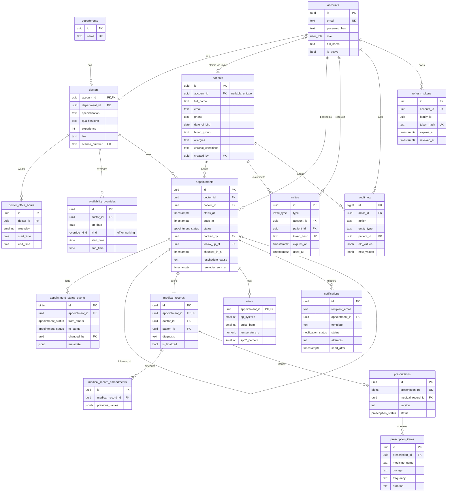

Version 1.0 · Companion to `PRD` and `API_DESIGN`

**Database:** PostgreSQL 14+ · **Migrations:** node-pg-migrate (SQL files in `src/db/migrations`) · **Extensions:** `btree_gist` (exclusion constraints), `pg_trgm` (name search)

**Conventions:** uuid primary keys, `timestamptz` for every time, emails stored trimmed and lowercased, no hard deletes of clinical or appointment data (foreign keys use `RESTRICT`, accounts are deactivated, protected tables have delete triggers), `updated_at` maintained by the `set_updated_at()` trigger.

Status key: **Applied** = already migrated, **Planned** = designed, not yet migrated.

---

## 1. ER Diagram

---

## 2. Enums

| Enum | Values | Notes |
|---|---|---|
| `user_role` | admin, doctor, receptionist, patient | One account has exactly one role |
| `appointment_status` | booked, checked_in, completed, cancelled, no_show, needs_reschedule | `checked_in` is added in its own migration |
| `override_kind` | off, working | `off` = not working that date; `working` = custom hours replacing the weekly template |
| `invite_type` | staff_invite, patient_claim, password_reset | |
| `notification_status` | pending, sent, failed | |
| `prescription_status` | active, superseded | |

---

## 3. Tables

### 3.1 Identity and people

**accounts** (Applied) – one login, one role. Email is unique across all roles.

| Column | Type | Notes |
|---|---|---|
| id | uuid PK | |
| full_name | text | Not blank, at most 120 characters |
| email | text | Unique. CHECK: equals lowercased, trimmed value |
| password_hash | text | NULL until the invite is accepted. Never plaintext |
| role | user_role | |
| is_active | boolean | Deactivate instead of delete |
| created_at, updated_at | timestamptz | `updated_at` kept by trigger |

Also `UNIQUE (id, role)`, the target of the role-pinned foreign keys below.

**departments** (Applied) – `id`, `name` (unique, not blank), `created_at`. A department with doctors cannot be deleted (foreign key `RESTRICT`).

**doctors** (Applied) – shares its primary key with accounts.

| Column | Notes |
|---|---|
| account_id | PK. Composite FK `(account_id, account_role)` to `accounts (id, role)` |
| account_role | Defaults to `doctor`, CHECK = `doctor`, so only doctor accounts can be doctors |
| department_id | FK to departments, `RESTRICT` |
| specialization, qualifications, bio | text. Bio at most 1000 characters |
| experience | integer, 0 to 70 |
| license_number | text, unique |

**patients** (Applied) – has its own id so walk-ins can exist without a login.

| Column | Notes |
|---|---|
| id | uuid PK |
| account_id | Unique, nullable. Filled when the patient claims an invite |
| account_role | Generated column: NULL when no account, `patient` once linked. Composite FK to `accounts (id, role)` pins linked accounts to the patient role |
| full_name, email, phone | CHECK: phone or email must be present. Email lowercased and unique when present |
| date_of_birth | Optional (a walk-in may not have it at the desk) |
| blood_group | One of A+, A-, B+, B-, AB+, AB-, O+, O- |
| allergies, chronic_conditions, emergency_contact | text. Editable by treating doctors inside the access window |
| created_by | FK to accounts: the receptionist, or the patient themself |

**invites** (Applied) – staff onboarding, patient account claim, password reset. Only a token hash is stored. A CHECK enforces the shape: staff_invite and password_reset need `account_id`; patient_claim needs `patient_id`. Columns: `type`, `account_id`, `patient_id`, `email`, `token_hash` (unique), `expires_at`, `used_at`, `created_by`, `created_at`.

### 3.2 Availability

**doctor_office_hours** (Planned) – weekly template. `doctor_id`, `weekday` (0 = Sunday to 6), `start_time`, `end_time`. CHECK end is after start. An exclusion constraint rejects overlapping ranges for the same doctor and weekday.

**availability_overrides** (Planned) – a date with any override replaces the weekly template for that date. `doctor_id`, `on_date`, `kind` (off or working), `start_time`, `end_time`, `reason`. CHECK: off rows have no times, working rows have a valid range. Overlapping working ranges are rejected, only one off row per doctor and date, and a trigger prevents a date from being both off and working.

### 3.3 Appointments

**appointments** (Planned) – the core table.

| Column | Notes |
|---|---|
| doctor_id, patient_id | FKs, `RESTRICT` |
| starts_at, ends_at | timestamptz. `ends_at` is start plus 20 minutes (15 consultation plus 5 buffer). The application sets the length; the database checks end is after start and at most one hour |
| status | `appointment_status`, default booked |
| booked_by | FK to accounts |
| follow_up_of | Self reference to the earlier appointment |
| cancelled_by, cancelled_at, cancel_reason | CHECK: set if and only if status is cancelled |
| reschedule_flagged_at, reschedule_cause | Required when status is needs_reschedule. Cause is `doctor_schedule_change` or `doctor_cancelled` |
| checked_in_at, checked_in_by | Required when status is checked_in |
| reminder_sent_at | Prevents duplicate 24-hour reminders; reset on reschedule |

Constraints and protections:
- `no_doctor_overlap`: exclusion constraint on (doctor, time range) where status is not cancelled
- `no_patient_overlap`: the same for the patient
- `UNIQUE (id, doctor_id, patient_id)`: lets medical records pin to the appointment’s doctor and patient
- A trigger blocks DELETE; rescheduling is an UPDATE of the times
- Indexes: `starts_at`, `status`, `(doctor_id, starts_at)`, `(patient_id, starts_at)`, a partial index for due reminders, and a partial index for the reschedule queue

**appointment_status_events** (Planned) – append-only history: `appointment_id`, `from_status`, `to_status`, `changed_by` (NULL for system), `reason`, `metadata` (old and new times for reschedules), `created_at`.

### 3.4 Clinical data

**medical_records** (Planned) – one visit record per appointment. `appointment_id` (unique), `doctor_id`, `patient_id`, `chief_complaint`, `diagnosis`, `notes`, `follow_up_date`, `is_finalized`, `finalized_at`. A composite FK `(appointment_id, doctor_id, patient_id)` to appointments means a record can never point at a different doctor or patient than its appointment. CHECK: `is_finalized` matches `finalized_at`. Delete blocked by trigger.

**medical_record_amendments** (Planned, P2) – append-only. `medical_record_id`, `amended_by`, `previous_values` (jsonb), `reason`.

**vitals** (Planned) – one row per appointment (`appointment_id` is the PK). `bp_systolic`, `bp_diastolic`, `pulse_bpm`, `temperature_c`, `weight_kg`, `height_cm`, `spo2_percent`, `recorded_by`. CHECK constraints reject impossible ranges (for example SpO2 above 100, or systolic not above diastolic).

**prescriptions** (Planned) – `medical_record_id`, `version`, `supersedes_id`, `status`, `general_advice`, `issued_at`, and `prescription_no` (identity, shown as RX-000123 on the PDF). A partial unique index allows only one active prescription per record. Delete blocked by trigger.

**prescription_items** (Planned) – free-text medicines: `prescription_id`, `position` (unique per prescription), `medicine_name`, `dosage`, `frequency`, `duration`, `instructions`. Length limits enforced.

### 3.5 Notifications, audit, and sessions

**notifications** (Planned) – the email outbox. `recipient_email`, optional links to account, appointment, invite, and prescription, `template`, `payload` (jsonb, no clinical text), `dedupe_key` (unique), `status`, `attempts`, `max_attempts`, `send_after`, `last_error`, `sent_at`. A partial index on pending rows serves the worker, which claims rows with `FOR UPDATE SKIP LOCKED`.

**audit_log** (Planned) – append-only (update and delete blocked by trigger). `actor_id` (NULL for system jobs), `actor_role`, `action`, `entity_type`, `entity_id`, `patient_id`, `old_values`, `new_values`, `ip_address`, `created_at`. Indexed by actor, patient, entity, and time.

**refresh_tokens** (Planned) – `account_id`, `family_id`, `token_hash` (unique), `expires_at`, `revoked_at`, `replaced_by`, `user_agent`, `ip_address`. Reuse of a rotated token revokes the whole family.

---

## 4. What the Database Guarantees

- **No double booking:** two exclusion constraints stop overlapping appointments for a doctor or a patient, even when requests arrive at the same instant, and even when a schedule change shifts the slot grid
- **Cancelled slots are free again; needs_reschedule slots stay held** until the receptionist resolves them
- **Roles cannot be mixed up:** only doctor accounts can be doctors, and only patient accounts can be linked to patients
- **Emails are normalized and unique** across every role
- **Clinical data cannot be orphaned or mismatched:** records are pinned to their appointment’s doctor and patient, and clinical and appointment rows cannot be deleted
- **The audit log and status history are append-only**
- **Schedules are coherent:** no overlapping office hours or overrides, and no date that is both off and working
- **Values are sane:** vitals ranges, blood group list, status-dependent columns (cancel, reschedule, check-in, finalize) are all checked

## 5. What the Service Layer Must Enforce

- Slot length is 20 minutes (the schema only checks end is after start)
- A patient or walk-in email must not match any staff account email (a CHECK cannot look at another table)
- A completed appointment requires a finalized visit record
- The doctor access window: from 20 minutes before the appointment starts until its slot ends
- The status state machine and who may trigger each transition
- Booking window (30 days ahead), minimum lead time, and cancellation rules
- The last active admin cannot be deactivated (lock the active admin rows inside a transaction first)
- Name and email on `accounts` and `patients` stay in sync when a walk-in claims an account

---

## 6. Migration Order

| Order | Migration | Contents | Status |
|---|---|---|---|
| 1 | `init-core-tables` | `set_updated_at`, `user_role`, accounts, departments, doctors, patients | Applied |
| 2 | `add-invites` | `invite_type`, invites | Applied |
| 3 | `add-availability` | Office hours, availability overrides, overlap rules | Planned |
| 4 | `add-appointments` | `btree_gist`, status enum, appointments, status events, indexes, delete protection | Planned |
| 5 | `add-checked-in-status` | Adds `checked_in` to the enum (own migration: Postgres cannot use a new enum value in the transaction that adds it) | Planned |
| 6 | `add-checked-in-columns` | `checked_in_at`, `checked_in_by`, check constraint | Planned |
| 7 | `add-medical-records` | Medical records, amendments, vitals | Planned |
| 8 | `add-prescriptions` | Prescriptions and items | Planned |
| 9 | `add-notifications` | Email outbox | Planned |
| 10 | `add-audit-log` | Append-only audit log | Planned |
| 11 | `add-refresh-tokens` | Refresh token storage | Planned |
| 12 | `add-account-lockout` | `failed_login_count`, `locked_until`, `last_login_at` on accounts | Planned |

Each migration only references tables created earlier. In development you can reset with `DROP SCHEMA public CASCADE; CREATE SCHEMA public;` and migrate again. Once a migration has run anywhere you care about, add a new migration instead of editing it.

## 7. Notes

- The PRD originally called the accounts table `users`; the schema name `accounts` is the one in use.
- The PRD data model lists `refresh_tokens` and `audit_logs`; the schema names are `refresh_tokens` and `audit_log`.
- If your migration files diverge from this document, update this document at the same time.
